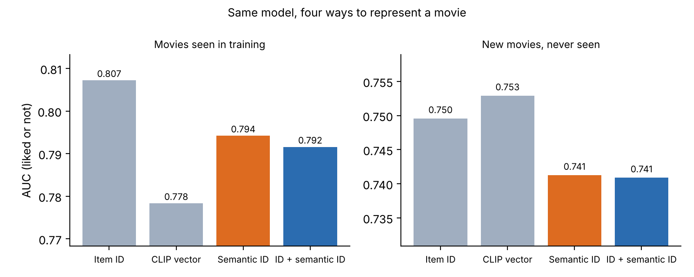
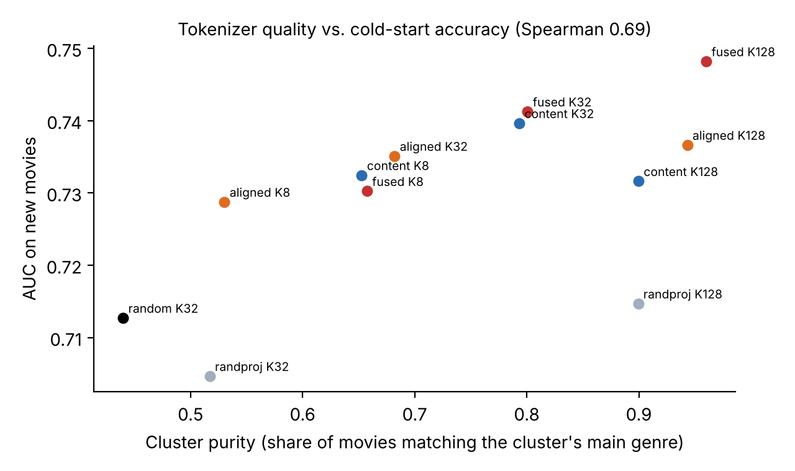

# Meta's semantic IDs (GenRecs tokenization), tested on MovieLens

An independent test of the idea in Meta's [GenRecs Tokenization](https://engineering.fb.com/2026/10/19/ml-applications/genrecs-tokenization-transforming-ads-recommendation-at-meta-with-stable-model-vocabulary/) post (Oct 2026), using the public recipe it builds on: semantic IDs with prefix n-grams ([Singh et al. 2023](https://arxiv.org/abs/2306.08121)).

The hypotheses and pass/fail rules were committed before any model was trained. See [PREREGISTRATION.md](PREREGISTRATION.md) and the first commit. Steps added after seeing a result are labeled in the notebook.

**Setup.** 857,000 real MovieLens ratings on 4,560 movies; target is liked (4+ stars). 20% of movies held out entirely as new items. Content: CLIP text embedding of title and genres. Twelve residual k-means tokenizers (3 levels). One small PyTorch model, five item representations.

## Results against the pre-registration

| | Hypothesis | Result | Verdict |
|---|---|---|---|
| H1 | On new movies, semantic IDs beat the CLIP vector | 0.741 vs 0.753 AUC (difference CI -0.013 to -0.010) | **Fail** |
| H2 | On known movies, semantic IDs within 0.005 of item IDs | 0.794 vs 0.807 | Fail |
| H3 | Engagement-aligned tokens beat content-only tokens on new movies | -0.005 at 32 codes; across 5 seeds from -0.007 to +0.015 | Fail |
| H4 | A codebook quality metric correlates with new-movie AUC (abs rho >= 0.6) | Purity rho 0.69 (p = 0.014); 0.52 and 0.46 in two earlier runs | Pass, fragile |
| H5 | ID + semantic ID beats semantic ID on the most popular movies | -0.003 | Fail |

Exploratory: random codes score 0.713 on new movies, so the semantic codes carry signal. Using only the first code level for new movies scores 0.748, better than all three levels (0.741). Across five more seeds, semantic IDs lose to the CLIP vector on new movies every time (by 0.006 to 0.035), and their new-movie AUC has a standard deviation of 0.012, against 0.001 for the CLIP vector. Training for 8 epochs instead of 4 makes every model worse and leaves the order unchanged.




## Caveats

MovieLens is small and the model is a factorization model, not a large sequence model where tokens are the vocabulary. Meta's reported gains come from that setting at a very different scale, and stability across campaigns can't be tested here. The content signal is text only.

## Files

- `meta_semantic_ids_replication.ipynb`: the full analysis, executed (about 40 minutes on 2 CPU cores).
- `semantic_ids.py`: the same code as a script (percent format).
- `figures/results.json`: every number quoted above.

## Run it

```
pip install numpy pandas scipy scikit-learn matplotlib pyarrow torch open_clip_torch
jupyter nbconvert --to notebook --execute meta_semantic_ids_replication.ipynb
```

## Credit

The ideas belong to the Meta GenRecs team and to Singh et al. This is an independent test for learning. Any mistakes are mine.
