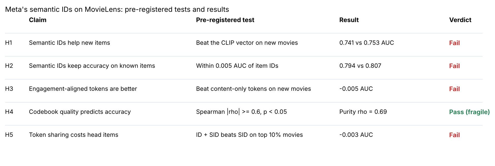

# I tested Meta's semantic IDs on MovieLens. A plain content embedding beat them on new items.

## Five predictions, written down before training. One held, and it didn't survive a change of random seed.

*Part 4 of Big Tech measurement, rebuilt.*

Every recommender has a new-item problem. A model that learns one embedding per item ID knows nothing about an item until people interact with it, so new ads, new products and new movies all start from zero. In October, Meta's ads team described [GenRecs tokenization](https://engineering.fb.com/2026/10/19/ml-applications/genrecs-tokenization-transforming-ads-recommendation-at-meta-with-stable-model-vocabulary/), their way around it, and reported a 0.35% lift in conversions.

## What Meta describes

Instead of a unique ID, each item gets a short code built from what it is. A content model turns the item into a vector, the vector is split into a few levels, and each level is snapped to the nearest entry in a codebook, a learned list of typical vectors. Two similar movies might get codes (12, 3, 40) and (12, 3, 7). They share the first parts, so a new item inherits what the model learned about its neighbors, and the model learns one embedding per code prefix rather than per item. Meta also says three simple quality measures of the codebooks, cluster purity, balance and codebook usage, correlated strongly with downstream accuracy across eight tokenizer versions. The public recipe behind this is [semantic IDs with prefix n-grams](https://arxiv.org/abs/2306.08121), from YouTube.

## How I tested it

I used about 857,000 real MovieLens ratings on 4,560 movies and predicted whether a user liked a movie, meaning four stars or more. I held out 20% of the movies completely, chosen evenly across popularity, so the model never saw a single rating for them. The content signal is CLIP's embedding of each movie's title and genres. The engagement signal is a factorization of who liked what, from training ratings only.

From these I built twelve tokenizers: content only, engagement only, or both, each with 8, 32 or 128 codes per level, plus three weak baselines including fully random codes. Then I trained the same small model with four item representations: a classic ID table (where every new movie shares one "unknown" embedding), the CLIP vector, semantic IDs, and IDs plus semantic IDs. Before training anything, I wrote down five hypotheses and committed them to git, and I fixed in the code which tokenizer would be the main one.

*Figure 1. The five pre-registered hypotheses, the rule each had to meet, and what happened.*

## A bug I almost missed

In my first run, the model with both representations gave exactly the same numbers as the model with semantic IDs alone, to four decimals. The cause was one line: I checked whether the word "id" appeared in the model's name, and it also appears inside "sid". Every semantic ID model had quietly been given an item ID table too, which made semantic IDs look closer to item IDs than they are. Everything below comes from the fixed code.

## What happened

On movies seen in training, semantic IDs scored an AUC of 0.794, below the plain item ID at 0.807. That's expected. Several movies share each code, so the model can no longer tell them apart. On new movies, which is the whole point, semantic IDs scored 0.741. The CLIP vector fed straight into the model scored 0.753, and even the item ID model, with a single shared embedding for every new movie, scored 0.750. My main hypothesis, that semantic IDs beat the dense content vector on new items, failed, with a bootstrap interval for the difference of -0.013 to -0.010.

*Figure 2. AUC of the same model with four item representations, on movies seen in training (left) and movies never seen (right).*

The codes weren't empty. Fully random codes scored 0.713 on new movies, so the semantic codes carried real information. The problem seemed to be the finest level. A new movie's full three-level code was learned from only a handful of known movies, so its embedding mostly memorized them. Scoring new movies with only the first level of their code gave 0.748, the first two levels 0.746, and all three 0.741.

The other predictions mostly failed too. Combining item IDs with semantic IDs did worse than item IDs alone, even on the 10% most popular movies. Codes that mixed in engagement didn't reliably beat content-only codes.

## Checking that it wasn't my setup

A negative result is only worth something if the comparison was fair, so I tried the two obvious ways it might not have been. The first was training time. Semantic ID embeddings are shared and updated less often than an ID table, so maybe four epochs was too few. With eight epochs every model got worse on held-out data, because all of them started to overfit, and semantic IDs stayed last on new movies (0.724, against 0.735 for CLIP and 0.747 for IDs).

The second was luck. I reran the key models end to end with five more random seeds. Semantic IDs lost to the CLIP vector on new movies with every seed, by between 0.006 and 0.035. But the seeds also showed how unstable the tokens are: the same tokenizer's accuracy on new movies had a standard deviation of 0.012 across seeds, against 0.001 for the CLIP vector.

## The one that held, and why I don't trust it much

Meta's claim about codebook quality did pass my test. Across the twelve tokenizers, cluster purity, the share of movies in a code group that share its main genre, correlated with accuracy on new movies at 0.69 (p = 0.014). But two earlier runs gave 0.52 and 0.46. One had the bug. In the other, the factorization behind the engagement signal wasn't seeded, so it came out slightly different, and so did every code built from it. With seed-to-seed noise of 0.012, larger than most gaps between tokenizers, a ranking of eight or twelve tokenizers from one run each is mostly noise. Balance didn't correlate with anything, and codebook usage was 100% in every version, so it couldn't.

*Figure 3. Cluster purity of each tokenizer against its AUC on new movies, from one seeded run.*

## Limits of this study

MovieLens is small, the content signal is text only, and my model is a factorization model, not the large sequence models where Meta uses tokens as the vocabulary. Much of the value Meta describes, like a vocabulary that stays stable across campaigns and better scaling, can't be tested on a dataset this size. My codebooks have three levels; production systems use more.

## What I take from it

This doesn't show that Meta is wrong. It shows that semantic IDs aren't a free win. In a small model, giving the content vector directly did better for new items, and a coarse code generalized better than a fine one. If I were evaluating a tokenizer at work, I'd run every version with several seeds before reading anything into a ranking, and I'd always keep the plain content vector in the comparison, because it's the baseline that's hardest to beat.

---

*Notebook and code: [github.com/ZFayFay/meta-semantic-ids-replication](https://github.com/ZFayFay/meta-semantic-ids-replication). The pre-registration is the first commit. The ideas belong to the Meta GenRecs team (Carl Hu, Justin Johnson, Parish Aggarwal, Kaushik Rangadurai, Senthil Manickavelu, Tianwei Zhang) and to Singh et al. for semantic IDs with prefix n-grams. This is an independent test of the idea in the [Meta post](https://engineering.fb.com/2026/10/19/ml-applications/genrecs-tokenization-transforming-ads-recommendation-at-meta-with-stable-model-vocabulary/). Any mistakes are mine.*
