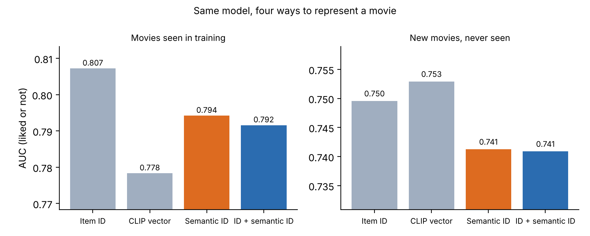

# I tested Meta's semantic IDs on MovieLens. A plain embedding beat them on new items.

## Five predictions, written down first. One held, and that one was fragile.

*Part 4 of Big Tech measurement, rebuilt.*

Every recommender has a new-item problem. A model that learns one embedding per item ID knows nothing about an item until people have interacted with it, so new ads, new products and new movies start from zero. In October, Meta's ads team described [GenRecs tokenization](https://engineering.fb.com/2026/10/19/ml-applications/genrecs-tokenization-transforming-ads-recommendation-at-meta-with-stable-model-vocabulary/), their answer to this. Instead of a unique ID, each item gets a short code built from what it is. A content model turns the item into a vector, the vector is broken into a few levels, and each level is snapped to the nearest entry in a codebook. Similar items share the first parts of their code, so a new item inherits what the model learned about its neighbors. Meta reports a 0.35% lift in conversions, and says that three simple quality measures of the codebooks (cluster purity, balance and codebook usage) correlated strongly with downstream accuracy across eight versions.

The public recipe behind this is [semantic IDs with prefix n-grams](https://arxiv.org/abs/2306.08121) from YouTube. I wanted to see what the idea does on a problem small enough to run on a laptop.

## How I set it up

I used about 857,000 real MovieLens ratings on 4,560 movies, and predicted whether a user liked a movie (four stars or more). I held out 20% of the movies completely, so the model never saw a rating for them. The content signal is CLIP's embedding of each movie's title and genres, and the engagement signal is a factorization of who liked what. I built twelve tokenizers, using content only, engagement only, or both, with three codebook sizes, plus three weak baselines including fully random codes. Then I trained the same small model with five different item representations: a classic ID table, the CLIP vector, semantic IDs, and both IDs together. Before training anything, I wrote down five hypotheses and committed them to git.

## A bug I almost missed

In my first run, the model with both representations gave exactly the same numbers as the model with semantic IDs alone, to four decimals. The cause was one line: I checked whether the word "id" appeared in the model's name, and it also appears inside "sid". Every semantic ID model had quietly been given an item ID table too, which made semantic IDs look closer to item IDs than they really are. The numbers below are from the fixed code.

## What happened

On movies seen in training, semantic IDs scored an AUC of 0.794, below the plain item ID at 0.807. That makes sense, since several movies share each code and the model can no longer tell them apart. On new movies, which is the whole point, semantic IDs scored 0.741. The CLIP vector fed straight into the model scored 0.753, and even the item ID model, which only has one shared "unknown" embedding for every new movie, scored 0.750. My main hypothesis, that semantic IDs beat the dense content vector on new items, failed clearly.

The codes weren't empty. Fully random codes scored 0.713 on new movies, so the semantic codes carried real information. The problem seemed to be the finest level of the code. A new movie's full code was learned from only a handful of known movies, so its embedding mostly memorized them. Scoring new movies with only the first level of their code gave 0.748, the first two levels 0.746, and all three 0.741.

The other predictions mostly failed as well. Codes that mixed in engagement didn't reliably beat content-only codes. And combining item IDs with semantic IDs did worse than item IDs alone, even on the most popular movies.

## The one that held, and why I don't trust it much

Meta's claim about codebook quality did pass my test. Across the twelve tokenizers, cluster purity, the share of movies in a cluster that share its main genre, correlated with accuracy on new movies at 0.69. But two earlier runs, one of them with the bug, gave 0.52 and 0.46. The difference came from something I'd missed: the factorization I used for engagement wasn't seeded, so it came out slightly different every time, and so did every code built from it. When I reran the key models with five seeds, the same tokenizer's accuracy on new movies had a standard deviation of 0.012 across seeds. That's bigger than most of the gaps between tokenizers. Balance didn't correlate with anything, and codebook usage was 100% in every version, so it couldn't.

## What I take from it

This doesn't say Meta is wrong. Their models are huge sequence models where tokens are the vocabulary, trained on billions of events, and much of the value they describe is stability across campaigns and scaling, which a MovieLens experiment can't test. What it does say is that semantic IDs are not a free win. In a small model, giving the model the content vector directly did better for new items, and a coarse code generalized better than a fine one. If I were evaluating a tokenizer at work, I would run every version with several seeds before reading anything into a ranking of eight versions, and I would always keep the plain content vector as a baseline.

---

*Notebook and code: [github.com/ZFayFay/meta-semantic-ids-replication](https://github.com/ZFayFay/meta-semantic-ids-replication). The pre-registration is the first commit. The ideas belong to the Meta GenRecs team (Carl Hu, Justin Johnson, Parish Aggarwal, Kaushik Rangadurai, Senthil Manickavelu, Tianwei Zhang) and to Singh et al. for semantic IDs with prefix n-grams. This is an independent rebuild of the [Meta post](https://engineering.fb.com/2026/10/19/ml-applications/genrecs-tokenization-transforming-ads-recommendation-at-meta-with-stable-model-vocabulary/).*
